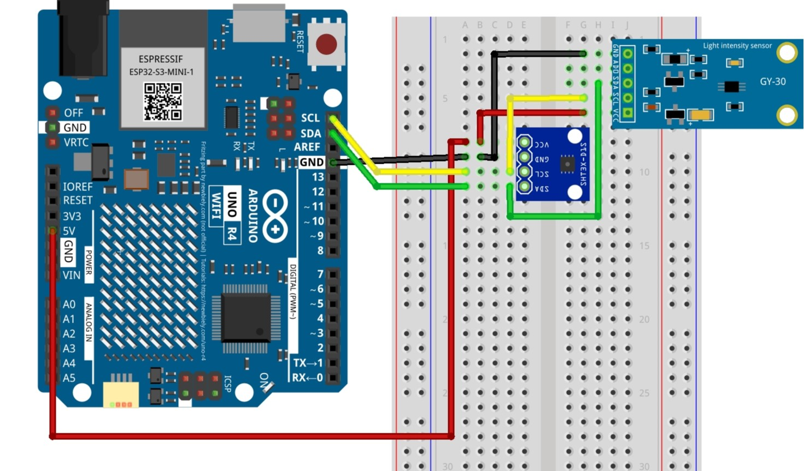

:::::::::::::::::::::::::::::::::::::: questions

- How do I read air temperature, humidity and light with I2C sensors?
- How can a board send its readings to an online spreadsheet?

::::::::::::::::::::::::::::::::::::::::::::::::

::::::::::::::::::::::::::::::::::::: objectives

- Wire two I2C sensors to a board
- Install the libraries and upload a ready-made sketch
- Edit the connection settings and log data to a shared Google Sheet

::::::::::::::::::::::::::::::::::::::::::::::::

## What we build

A small environmental station with two sensors:

- **SHT31**: air temperature and air humidity;
- **BH1750**: light intensity, in lux.

The sketch also calculates the **dew point**: the temperature at which water
vapour in the air condenses on leaves, glass and electronics.

Both sensors talk to the board through **I2C**: they share the same two data
wires (SDA and SCL), and each sensor has its own address on that bus.

We work in two steps:

1. **Read the sensors** and print the values in the Serial Monitor.
2. **Log them online**: every 30 seconds, the board sends its readings to a
   Google Sheet shared by the whole class.

## Which sketch for which board

| Your board | Step 1: read the sensors | Step 2: log online |
|------------|--------------------------|--------------------|
| UNO R3 or UNO R4 Minima | `ENV_BASE` | not possible: no Wi-Fi |
| UNO R4 WiFi | `ENV_BASE` | `R4WiFi_ENV_BASE_google_log` |
| ESP32-C3 SuperMini | `ENV_BASE` | `ESP32_ENV_BASE_google_log` |

## Wiring

Both sensors connect to the **same four wires**.

{alt='Breadboard drawing. An Arduino UNO R4 WiFi is connected to a breadboard with four wires: red from 5V, black from GND, yellow from SCL and green from SDA. An SHT31 temperature and humidity sensor and a GY-30 light sensor (BH1750) are both connected to these same four lines.'}

The wire colours: **red** = VCC, **black** = GND, **yellow** = SCL,
**green** = SDA. On an ESP32-C3, use the same colours, with the pins in the
right-hand column of the table below.


| Sensor pin | UNO R3 / R4 Minima / R4 WiFi | ESP32-C3 SuperMini |
|------------|------------------------------|--------------------|
| VCC | 5V | 3V3 |
| GND | GND | GND |
| SCL | SCL (also A5) | GPIO 9 |
| SDA | SDA (also A4) | GPIO 8 |

::::::::::::::::::::::::::::::::: caution

### Two things to watch

- The ESP32-C3 works at **3.3 V**: power the sensors from **3V3**, and never
  connect 5 V to its pins (see
  [Good electronics practices](good-electronics-practices.md)).
- On the UNO R4 WiFi, use the **SCL and SDA pins**, not the small Qwiic
  connector: the Qwiic connector is a second I2C bus, which these sketches do
  not use.

:::::::::::::::::::::::::::::::::::::::::

::::::::::::::::::::::::::::::::::::: checklist

### Before you start

- Arduino IDE installed, and the board package for your board:
  **Arduino UNO R4 Boards**, or **esp32 by Espressif Systems**
- Library **SHT31 by Rob Tillaart** installed (**Tools → Manage Libraries**,
  search "SHT31"). Other SHT31 libraries use different commands: pick the one
  by Rob Tillaart.
- Library **BH1750 by Christopher Laws** installed
- ESP32-C3 only: board **ESP32C3 Dev Module**, and
  **Tools → USB CDC On Boot → Enabled**. Without this setting, the Serial
  Monitor stays empty.
- Serial Monitor set to **9600 baud**

::::::::::::::::::::::::::::::::::::::::::::::::

::::::::::::::::::::::::::::::::: callout

### Two ways to get a sketch into the IDE

- **Download** the file with the link above each sketch and open it in the
  Arduino IDE. When the IDE offers to create a folder for it, accept.
- **Copy and paste**: in the IDE, choose **File → New Sketch** and delete
  everything in it. Then select the whole code box on this page, from the
  first `/*` to the last `}`, copy it, and paste it into the empty sketch.
  Save it with a name without spaces.

:::::::::::::::::::::::::::::::::::::::::

## Step 1: read the sensors

[Download ENV_BASE.ino](files/ENV_BASE.ino)

```C
/*
Environmental station demo. IOT-NSP, Session #3 
V0: 23 November 2026.
Author: Leone Magliocchetti Lombi

Example sketch to demonstrate the use of 2 environmental sensors
using i2c communication protocol.
Sensors:
- SHT31 (Air Temprature, Air Humidity)
- BH1750 (Light instensity)

Wiring: 
Sensors   5V  GND SCL SDA
Arduino   5V  GND SCL SDA
*/

#include "Wire.h"           //import i2C library
#include "SHT31.h"          //import SHT31 library by Rob Tllart
#include <BH1750.h>         //import BH1750 library by Christopher Laws

//#define SHT31_ADDRESS     //define sht31 address - necessary to use the library

SHT31 sht;                  //create an SHT31 instance and name it sht

BH1750 lightMeter;          //create an BH1750 instance and name it lightMeter

//declare variables
float humidity = 0;
float temperature = 0;
float lux = 0;
float dew_point = 0;

void setup() {
  Serial.begin(9600);       //open the Serial port
  Wire.begin();             //open the i2c communication port
  sht.begin();              //open and start the SHT sensor 
  lightMeter.begin();
}

void loop() {
  delay(2000);
  sht.read();
  humidity = sht.getHumidity();
  temperature = sht.getTemperature();
  lux = lightMeter.readLightLevel();
  dew_point = calculate_dewPoint(temperature, humidity);

  Serial.print("Air temperature: ");  Serial.print(temperature);  Serial.println("°C");
  Serial.print("Air humidity: ");     Serial.print(humidity);     Serial.println("%");
  Serial.print("Light intensity: ");  Serial.print(lux);          Serial.println("lx");
  Serial.print("Dew Point: ");        Serial.print(dew_point);    Serial.println("°C");
  Serial.println("----------");

}

float calculate_dewPoint(float temperature, float rh) {
  float t_dew_point = temperature - ((100 - rh)/5);
  return t_dew_point; 
}
```

Open the Serial Monitor. Every 2 seconds you should see something like:

```output
Air temperature: 24.50°C
Air humidity: 60.00%
Light intensity: 350.00lx
Dew Point: 16.50°C
----------
```

::::::::::::::::::::::::::::::::::::: challenge

## Challenge: breathe on it

Breathe gently on the SHT31, then cover the BH1750 with your hand. What
happens to each value, and why does the dew point change too?

:::::::::::::::::::::::: solution

Your breath is warm and full of water vapour: temperature and especially
humidity rise. The dew point rises too, because it depends on how much water
vapour is in the air. Covering the BH1750 makes the light intensity drop
towards 0 lx, while the other values do not change.

:::::::::::::::::::::::::::::::::

::::::::::::::::::::::::::::::::::::::::::::::::

## Step 2: log your data to a Google Sheet

### How it works

Every second, the board reads the sensors. Every 30 seconds, it builds a web
address that contains the readings, like this one:

```output
https://script.google.com/macros/s/.../exec?token=...&student=your_name&light=350.00&temperature=24.50&humidity=60.00
```

The board then opens this address, just as a browser would. The address leads
to a small program (a Google Apps Script) attached to the class spreadsheet,
which writes the values as a new row. The 30-second wait between submissions
uses `millis()`, as in [Keeping time with millis()](millis-direction.md).

### Edit the connection settings

In the block marked `EACH STUDENT TO EDIT THESE`, change:

| Line | What to write |
|------|---------------|
| `WIFI_SSID` | the name of the Wi-Fi network |
| `WIFI_PASS` | its password |
| `STUDENT` | your name, **without spaces** (for example `maria_rossi`) |
| `TOKEN` | only if the instructor gives you a new token |

Keep the quotation marks around each value. A space in your name breaks the
web address.

::::::::::::::::::::::::::::::::: caution

### Keep your password private

Once you have typed your Wi-Fi password into a sketch, do not share or
publish that sketch without removing the password first.

:::::::::::::::::::::::::::::::::::::::::

### UNO R4 WiFi

[Download R4WiFi_ENV_BASE_google_log.ino](files/R4WiFi_ENV_BASE_google_log.ino)

```C
/*
Environmental station demo. IOT-NSP, Session #3
V0: 26 November 2026.
Author: Leone Magliocchetti Lombi
For Arduino UNO R4 WiFi
 
Example sketch to demonstrate the use of 2 environmental sensors using i2c communication protocol,
and log their values to a google sheet.
Sensors:
- SHT31 (Air Temprature, Air Humidity)
- BH1750 (Light instensity)
 
Wiring pins:
Sensors      VCC  GND SCL SDA
UNO R4 WiFi  5V   GND SCL SDA
 
Updates:
26 November: now the data are logged to an online google sheet.
The loop function does three things:
1: read the value from the sensors
2: delay waiting the time to send data
3: call the function that sends the data
 
Custom functions are:
calculate_dewPoint()  -> receives float values temperature and humidity and return temperature of dew point. Type float.
sendData()            -> receives the variables values and sends them to the google sheet through wifiClient. Void.
printResult()         -> receives the server answer and print the result of the call to the serial port. Void.
 
This version differs from the one for the ESP32 (wifi library and behaviour on redirects)
*/
 
//import wifi related libraries
#include <WiFiS3.h>         //WiFi library of the UNO R4 WiFi (includes WiFiSSLClient)
//import sensors related libraries
#include "Wire.h"           //import i2C library
#include "SHT31.h"          //import SHT31 library by Rob Tllart
#include <BH1750.h>         //import BH1750 library by Christopher Laws
 
//#define SHT31_ADDRESS     //define sht31 address only when needed.
SHT31 sht;                  //create an SHT31 instance and name it sht
BH1750 lightMeter;          //create an BH1750 instance and name it lightMeter
 
//declare variables
float humidity = 0;
float temperature = 0;
float lux = 0;
float dew_point = 0;
 
// ---- EACH STUDENT TO EDIT THESE to handle the connection ----
const char* WIFI_SSID  = "your-wifi-network";
const char* WIFI_PASS  = "your-wifi-password";
//script url is specific to the google sheet project and owner
//(in this case Leone :) for the sake of the demo)
//for your own project you will set this link up through your google account.
//On this board the URL is split in two: the server (HOST) and the rest (SCRIPT_PATH).
const char* HOST        = "script.google.com";
const char* SCRIPT_PATH = "/macros/s/AKfycbzKh9zmajSR-xS1C4m5aRB4BpUt6UVkTUvaiOb3HMtxXVQ47mf3I191yXk4VSm4hDEt/exec";
const char* TOKEN      = "iot2026";       //token id for today
const char* STUDENT    = "Leone";         // your name without space
// --------------------
 
const unsigned long INTERVAL_MS = 30000;  // one reading every 30 s (keep at 30 s or more)
unsigned long last_submission = 0;
 
void setup() {
  Serial.begin(9600);
  Serial.print("Connecting to WiFi");
  while (WiFi.begin(WIFI_SSID, WIFI_PASS) != WL_CONNECTED) {
    delay(500);
    Serial.println("...");
  }
  delay(1000);              //give the board a moment to receive its IP address
  Serial.println();
  Serial.print("Connected, IP: ");
  Serial.println(WiFi.localIP());
 
  Wire.begin();             //open the i2c communication port: default SDA/SCL pins of the UNO R4
  sht.begin();              //open and start com with the SHT sensor
  lightMeter.begin();       //open and start com with the BHT sensor
}
 
void loop() {
  // Step 1: Read the sensors
  sht.read();
  humidity = sht.getHumidity();
  temperature = sht.getTemperature();
  lux = lightMeter.readLightLevel();
  dew_point = calculate_dewPoint(temperature, humidity);
 
  Serial.print("Air temperature: ");  Serial.print(temperature);  Serial.println("°C");
  Serial.print("Air humidity: ");     Serial.print(humidity);     Serial.println("%");
  Serial.print("Light intensity: ");  Serial.print(lux);          Serial.println("lx");
  Serial.print("Dew Point: ");        Serial.print(dew_point);    Serial.println("°C");
  Serial.println("----------");
 
  // Step 2: check if the delay time between subission is past
  if ((millis() - last_submission) >= INTERVAL_MS){
    //Step 3: Send sensors variable tover the internet
    sendData(lux, temperature, humidity);
    last_submission = millis();
  }
 
  delay(1000);
}
 
 
 
  /*
  sendData()
  This function receives the value from the sensors and
  sends them to the selected web service.
  */
void sendData(float light, float temperature, float humidity) {
 
  if (WiFi.status() != WL_CONNECTED) {
    printResult(-1, "WiFi not connected");
    return;
  }
  //Concatenate all the pieces to build for the fulll request (path only, the server is HOST)
  String request = SCRIPT_PATH;
  request += "?token=";
  request += TOKEN;
  request += "&student=";
  request += STUDENT;
  request += "&light=";
  request += light;
  request += "&temperature=";
  request += temperature;
  request += "&humidity=";
  request += humidity;
 
  WiFiSSLClient client;                   // secure (https) client of the UNO R4
 
  if (!client.connect(HOST, 443)) {       // open the connection to Google on the https port
    printResult(-1, "connection to server failed");
    return;
  }
 
  // write the http request line by line, as a browser would
  client.println("GET " + request + " HTTP/1.1");
  client.print("Host: ");
  client.println(HOST);
  client.println("Connection: close");
  client.println();                       // empty line = end of the request
 
  // wait up to 10 s for the first line of the answer, e.g. "HTTP/1.1 302 Moved Temporarily"
  unsigned long start = millis();
  while (!client.available() && millis() - start < 10000) {
    delay(10);
  }
  String status = client.readStringUntil('\n');
  client.stop();
 
  int code = -1;                        //create an int variable to store the code received.
  if (status.startsWith("HTTP/")) {
    code = status.substring(9, 12).toInt();   // the 3 digits after "HTTP/1.1 "
  }
  if (code == -1) status = "no answer from server";
 
  printResult(code, status);
}
 
// Prints success, or "error" followed by what went wrong
// On the UNO R4, 302 (redirect) means the row has been written
void printResult(int code, String message) {
  if (code == 302 || code == 200) {
    Serial.println("Successfully sent data");
  } else {
    Serial.print("Error (");
    Serial.print(code);
    Serial.print("): ");
    Serial.println(message);
  }
}
 
float calculate_dewPoint(float temperature, float rh) {
  float t_dew_point = temperature - ((100 - rh)/5);
  return t_dew_point;
}
```

### ESP32-C3 SuperMini

[Download ESP32_ENV_BASE_google_log.ino](files/ESP32_ENV_BASE_google_log.ino)

```C
/*
Environmental station demo. IOT-NSP, Session #3 
V0: 26 November 2026.
Author: Leone Magliocchetti Lombi
Tested on ESP32-C3 Super mini

Example sketch to demonstrate the use of 2 environmental sensors
using i2c communication protocol.
Sensors:
- SHT31 (Air Temprature, Air Humidity)
- BH1750 (Light instensity)

Wiring: 
Sensors VCC GND SCL SDA
ESP32S3 3V  GND SCL SDA

Updates:
26 November: now the data are logged to an online google shee.
The loop function does three things:
1: read the value from the sensors
2: delay waiting the time to send data
3: call the function that sends the data

Custom functions are:
calculate_dewPoint()  -> receives float values temperature and humidity and return temperature of dew point. Type float.
sendData()            -> receives the variables values and sends them to the google sheet through wifiClient. Void.
printResult()         -> receives the server answer and print the result of the call to the serial port. Void.
*/

//import wifi related libraries
#include <WiFi.h>
#include <WiFiClientSecure.h>
#include <HTTPClient.h>
//import sensors related libraries
#include "Wire.h"           //import i2C library
#include "SHT31.h"          //import SHT31 library by Rob Tillart
#include <BH1750.h>         //import BH1750 library by Christopher Laws

//#define SHT31_ADDRESS     //define sht31 address only when needed.
SHT31 sht;                  //create an SHT31 instance and name it sht
BH1750 lightMeter;          //create an BH1750 instance and name it lightMeter

//declare variables
float humidity = 0;
float temperature = 0;
float lux = 0;
float dew_point = 0;

// ---- EACH STUDENT TO EDIT THESE to handle the connection ----
const char* WIFI_SSID  = "your-wifi-network";
const char* WIFI_PASS  = "your-wifi-pwd";
//script url is specific to the google sheet project and owner
//(in this case Leone :) for the sake of the demo)
//for your own project you will set this link up through your google account.
const char* SCRIPT_URL = "https://script.google.com/macros/s/AKfycbzKh9zmajSR-xS1C4m5aRB4BpUt6UVkTUvaiOb3HMtxXVQ47mf3I191yXk4VSm4hDEt/exec";
const char* TOKEN      = "iot2026";       //token id for today
const char* STUDENT    = "Lorenz";          // your name without space
// --------------------

const unsigned long INTERVAL_MS = 30000;  // one reading every 30 s (keep at 30 s or more)
unsigned long last_submission = 0;

void setup() {
  Serial.begin(9600);
  WiFi.begin(WIFI_SSID, WIFI_PASS);
  Serial.print("Connecting to WiFi");
  while (WiFi.status() != WL_CONNECTED) {
    delay(500);
    Serial.println("...");
  }
  Serial.println();
  Serial.print("Connected, IP: ");
  Serial.println(WiFi.localIP());
  
  //Wire.begin(8,9);        //open the i2c communication on specified pins
  Wire.begin();             //open the i2c communication on default pins
  sht.begin();              //open and start the SHT sensor 
  lightMeter.begin();       //open and start the BHT sensor 
}

void loop() {
  // Step 1: Read the sensors
  sht.read();
  humidity = sht.getHumidity();
  temperature = sht.getTemperature();
  lux = lightMeter.readLightLevel();
  dew_point = calculate_dewPoint(temperature, humidity);

  Serial.print("Air temperature: ");  Serial.print(temperature);  Serial.println("°C");
  Serial.print("Air humidity: ");     Serial.print(humidity);     Serial.println("%");
  Serial.print("Light intensity: ");  Serial.print(lux);          Serial.println("lx");
  Serial.print("Dew Point: ");        Serial.print(dew_point);    Serial.println("°C");
  Serial.println("----------");

  // Step 2: check if the delay time between subission is past
  if ((millis() - last_submission) >= INTERVAL_MS){   
    //Step 3: Send sensors variable tover the internet
    sendData(lux, temperature, humidity);
    last_submission = millis();
  }

  delay(1000);
}

  /*
  sendData()
  This function receives the value from the sensors and
  sends them to the selected web service.
  */
void sendData(float light, float temperature, float humidity) {

  if (WiFi.status() != WL_CONNECTED) {
    printResult(-1, "WiFi not connected");
    return;
  }
  //Concatenate all the pieces to build for the fulll request
  String request = SCRIPT_URL;
  request += "?token=";
  request += TOKEN;
  request += "&student=";
  request += STUDENT;
  request += "&light=";
  request += light;
  request += "&temperature=";
  request += temperature;
  request += "&humidity=";
  request += humidity;

  WiFiClientSecure client;                // create a new client instance, and name it... "client"?
  client.setInsecure();                   // skip certificate check (fine for a class demo)

  HTTPClient http;
  http.setFollowRedirects(HTTPC_STRICT_FOLLOW_REDIRECTS);   // to ensure we follow thegoogles redirect
  http.begin(client, request);                              // send the http request using the client instance and the request
  int code = http.GET();                                    //this array will store the server's application reply

  String reply;
  if (code > 0) reply = http.getString();          // text sent back by the server
  else          reply = http.errorToString(code);  // network problem, no reply
  http.end();

  printResult(code, reply);
}

// Prints success, or "error" followed by what went wrong
void printResult(int code, String message) {
  if (code == 200 && message == "OK") {
    Serial.println("Successfully sent data");
  } else {
    Serial.print("Error (");
    Serial.print(code);
    Serial.print("): ");
    Serial.println(message);
  }
}

float calculate_dewPoint(float temperature, float rh) {
  float t_dew_point = temperature - ((100 - rh)/5);
  return t_dew_point; 
}
```

### What you should see

```output
Connecting to WiFi...
...
Connected, IP: 192.168.1.50
Air temperature: 24.50°C
Air humidity: 60.00%
Light intensity: 350.00lx
Dew Point: 16.50°C
----------
Successfully sent data
```

"Successfully sent data" appears about once every 30 seconds. Then look for
your name in the shared sheet.

::::::::::::::::::::::::::::::::: callout

### Why are there two versions?

The two boards use different Wi-Fi libraries. Google answers each request
with a *redirect* (code 302): "the result is at another address".

- On the **ESP32**, the `HTTPClient` library follows the redirect and reads
  the script's answer. It reports success only when the script replies "OK".
- On the **UNO R4 WiFi**, the sketch writes the request line by line and only
  reads the first line of the answer. Code 302 means the script was reached,
  but not whether it accepted the data. Check the sheet to see your row.

:::::::::::::::::::::::::::::::::::::::::

## Troubleshooting

| What you see | What to check |
|--------------|---------------|
| Nothing at all in the Serial Monitor (ESP32-C3) | **Tools → USB CDC On Boot → Enabled**, then upload again |
| Strange characters | Serial Monitor speed: 9600 baud |
| `-45.00°C` and `0.00%` | the SHT31 does not answer: check VCC, GND, and that SDA and SCL are not swapped |
| Light intensity `-1.00` or `-2.00` | the BH1750 does not answer: same checks |
| "Connecting to WiFi" and dots that never stop | network name and password (capitals count); the network must be 2.4 GHz |
| The same, on an ESP32-C3 SuperMini, with the right password | add the line `WiFi.setTxPower(WIFI_POWER_8_5dBm);` just below `WiFi.begin(WIFI_SSID, WIFI_PASS);`: it lowers the radio power, which fixes many of these boards |
| `Error (-1): WiFi not connected` | the connection dropped: press the reset button |
| `Error (200): ...` followed by a message (ESP32) | the script refused the data: check `TOKEN` and `STUDENT` |
| Success, but no row in the sheet (UNO R4 WiFi) | check `TOKEN` and `STUDENT` |

::::::::::::::::::::::::::::::::::::: instructor

The Google Sheet and its Apps Script belong to the instructor. The script
address and the token of the day are both public on this page: change the
token in the Apps Script after the session.

::::::::::::::::::::::::::::::::::::::::::::::::

::::::::::::::::::::::::::::::::::::: keypoints

- Several I2C sensors can share the same two data wires, each with its own address.
- Install the exact libraries the sketch names: libraries for the same sensor can use different commands.
- To log data online, a board builds a web address containing its readings and opens it, just like a browser.
- Edit only the marked lines: Wi-Fi name, password and your name without spaces.

::::::::::::::::::::::::::::::::::::::::::::::::
