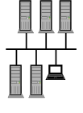
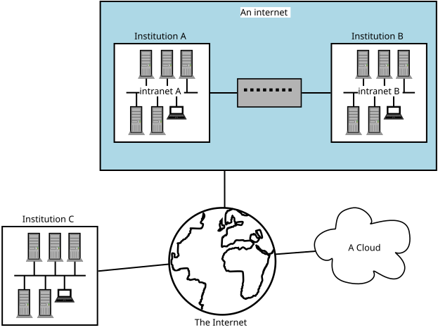
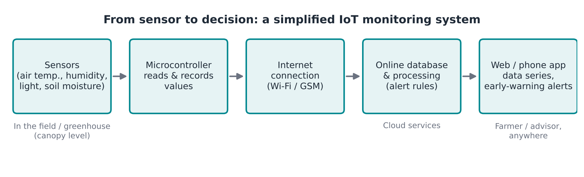

:::::::::::::::::::::::::::::::::::::: questions
<!-- New box with typeID (questions, objectives, callout...) -->

- What is the Internet of Things (IoT)?
- Can open-source technology and IoT bring precision agriculture to smallholder farmers?
- How does an electronic sensor turn the environment into data?
- What does a complete IoT monitoring system look like?
- Why does owning the technology and the data matter?

::::::::::::::::::::::::::::::::::::::::::::::::
<!-- To close the box -->

::::::::::::::::::::::::::::::::::::: objectives

- Explain how crop-specific environmental needs lead to science-based advice
- Describe how a sensor converts an environmental parameter into a measurable signal
- Explain what the Internet of Things is, and the basic network terms behind it
- Outline the parts of an IoT system, from sensor to alert
- Compare the benefits and limitations of proprietary and open-source systems

::::::::::::::::::::::::::::::::::::::::::::::::

Note: for development and illustration purposes, some content in this episode
has been copied verbatim from the Carpentries Incubator lesson
[Introduction to the Internet of Things (iot-novice)](https://github.com/carpentries-incubator/iot-novice).

## The guiding question
<!-- '##' = section heading (shows in the page's table of contents). '###' = sub-section. -->

This lesson introduces the use of Internet of Things (IoT) devices in the
agrifood sector. Throughout the course we keep coming back to one question:

> Will open-source technology and IoT popularize precision agriculture among
> smallholder farmers?
<!-- '>' renders as a highlighted quote -->

To answer it, we need to understand how the technology works, so that we can
adapt it to the challenges and projects we work on in agrifood systems (AFS)
and horticulture. That is why we start by stepping back to the basics:
understanding the building blocks is what allows us to make a leap later.

## From plant needs to science-based advice

Plants respond to their environment, and different crops have different
environmental needs. Take a single parameter, temperature:

| Crop     | At 25 °C                        |
|----------|---------------------------------|
| Broccoli | In its "dead zone": poor growth |
| Maize    | Good growing conditions         |

Matching what a crop needs with the conditions actually measured is, in a
nutshell, how science-based advice works.

## From theory to practice: electronic sensors

How do we know the real conditions in a specific field or greenhouse?
An **electronic sensor** focuses on one parameter and makes something
intangible (temperature, humidity, pH) measurable by converting it into an
**electrical signal**.

The principle is simple. A microcontroller sends a known voltage through a
circuit that includes the sensor. When the parameter changes, the sensor
changes that voltage, for example from 4 V to 3.8 V. The microcontroller
measures the difference and, using the sensor's known response (its
calibration), converts it into a value such as °C or % humidity.

::::::::::::::::::::::::::::::::: callout

### Isolating the violin

The environment is complex: many things happen at the same time. A sensor
lets us isolate one parameter from that complexity, like listening to an
orchestra and choosing to hear only the violin.

:::::::::::::::::::::::::::::::::::::::::

The same principle applies far beyond horticulture: aquaculture, livestock
and poultry farming, and even home automation (domotics).

## What sensors can tell us

### One parameter, one agronomic meaning

**Humidity** influences water uptake, transpiration and the development of
pathogens. These in turn affect how much a crop produces, and therefore how
much the farmer earns.

### Several parameters combined

By combining **light intensity, temperature and humidity**, and comparing
them with the known conditions that favour pests and diseases (for example
fungal diseases), a system can **trigger an alert** when the risk is high.

### The fourth factor: time

A single reading tells us what is happening now. But what about yesterday?
Fungal diseases often become visible only after the crop is already infected.
If something had been measuring constantly, we could have had an
**early warning**. This is why we automate the recording of parameters, and
connect our sensors to the Internet.

## The Internet of Things

You might hear "Internet of Things" (IoT) and Arduino mentioned together and
often those terms are used as if the one implies the other. However, this is
not the case. The **Internet of Things** refers to all kinds of "Things" that
have been connected to the Internet. Often, this includes sensing the
environment. You can almost think of IoT as the five senses of the Internet.

Before we continue, we should clarify some key terminology used in
networking. When two or more computers are connected such that they can
communicate it is called a **network**.

### LAN

When computers are connected together as in the below diagram, we call this a
**"Local Area Network"**, or LAN. This is how the computers within a
university campus, or within a farm office and its greenhouses, are connected.
You may hear this referred to as the institution's **intranet**. All the
computers inside it can talk to each other, but computers outside the LAN
cannot talk to them.

{alt='Diagram of several computers linked to each other in one local network.'}

### WAN

A LAN is often connected to other telecommunications networks. The network of
university networks in the UK is called "[Janet](https://www.jisc.ac.uk/janet)":
this allows institutions to talk to each other. This forms a
**"Wide Area Network"** or WAN, as it spans a much larger geographic distance.
This network may also be referred to as **an internet** but is not the same as
**The Internet**.

{alt='Diagram of two local networks joined together, and connected to the worldwide Internet.'}

### "The Internet" versus "an internet"

An "internet" (with a lower case i) and "The Internet" (with an upper case I)
are different! With an upper case I, **The Internet** refers to the wide area
network that we connect to view web pages such as Google, Amazon etc, or to
which we connect to make Zoom or Skype calls. The Internet is a worldwide
collection of networks that we are able to connect to via our Internet
Service Providers.

With a lower case i, **internet** refers to a collection of networks that are
connected: a contraction of the phrase "*interconnected network*". If
university A has a network on campus, and university B has a network, and
they decide to connect the two networks as a WAN, then they would have an
internet. However they might not necessarily be connected to The Internet.

::::::::::::::::::::::::::::::::::::: challenge

## Challenge: network basics

- What is a network?
- What is an intranet?
- What is the Internet?
- What is the difference between a LAN and a WAN?

:::::::::::::::::::::::: solution

## Answers

- **Network**: a group of computers connected together. This can be via wires
  (electrically); microwaves (radio); or fibre optic (light).
- **Intranet**: a network of computers, such as the one connecting machines
  within the University to each other.
- **The Internet**: the network of networks, which connects computers across
  the globe together.
- A **Local Area Network** is situated in a small geographic area. A
  **Wide Area Network** may span countries, or even the globe. We are even
  starting to have PANs (Planetary Area Networks)!

:::::::::::::::::::::::::::::::::

::::::::::::::::::::::::::::::::::::::::::::::::

## From sensor to alert: how an IoT system works

Putting sensors and networks together gives us a complete IoT monitoring
system:

{alt='Flow diagram with five boxes: sensors in the field, a microcontroller that records values, an internet connection, an online database with processing and alert rules, and a web or phone app used by the farmer or advisor.'}

1. **Sensors** measure the parameters in the field or greenhouse.
2. A **microcontroller** reads and records the values automatically.
3. The device **connects to the internet** and saves the data online.
4. An **online program** processes the data and triggers alerts. Historical
   data can be reviewed, and combined with forecasting models.
5. An **app** gives the user access to the data from anywhere: the farmer,
   but also an extension officer working remotely.

::::::::::::::::::::::::::::::::: callout

### The Cloud

Steps 4 and 5 usually happen "in the cloud". You may have heard of
**The Cloud**. The cloud refers to a collection of many, many computers which
provide services and resources on the Internet. These machines might be
physically located in datacentres all over the globe, but the network between
them is designed to be as invisible as possible to you. We often don't care
where the computer running a service in the cloud physically resides, as long
as the service is reliable and can be accessed from the Internet.

This ephemerality is why we talk about services as if they are in a "cloud":
the computers and the services they run are like droplets of water floating
in the sky. There are also multiple clouds in the "sky": some operated by
technology companies, others smaller, such as private clouds hosted by
individual institutions or companies for reasons including cost and security.

:::::::::::::::::::::::::::::::::::::::::

::::::::::::::::::::::::::::::::: callout

### Not a replacement for the field

Farmers still need to walk their fields. IoT adds a layer of information that
supports **data-driven decision-making**, for example by letting you go back
and see what happened in the days before a problem appeared.

:::::::::::::::::::::::::::::::::::::::::

::::::::::::::::::::::::::::::::::::: challenge

## Challenge: which of the following are part of the Internet of Things?

With the person next to you, discuss whether you think the following devices
are part of the Internet of Things, and why. What other devices do you think
would be part of the Internet of Things?

1. A computer
2. An Arduino
3. A traffic camera
4. A device publishing current temperature to the Internet
5. A smart phone

:::::::::::::::::::::::: solution

## Discussion points

1. **A computer** is connected to the Internet, but it is a general-purpose
   machine rather than a "thing" sensing its environment. Usually not counted
   as IoT.
2. **An Arduino** on its own has no Internet connection, so it is not part of
   the IoT. It becomes part of it once it is connected.
3. **A traffic camera** that sends images or counts over the network is a
   typical IoT device.
4. **A device publishing current temperature to the Internet** is the classic
   IoT example, and exactly what we will build.
5. **A smart phone** is debatable: it is full of sensors and connected, but it
   is also a general-purpose computer. It often acts as the gateway between
   IoT devices and their users.

:::::::::::::::::::::::::::::::::

::::::::::::::::::::::::::::::::::::::::::::::::

## Where we are going

The system above is a finished product. Over the next lessons we will build up
to it step by step, through theory and practical exercises: how to code, how
to wire, and the basics of electronics. At the end of the series,
participants will be able to set up, control and maintain their own sensor
networks.

Two principles guide the way:

- **Always focus on the final result.** There are many ways to solve a
  problem in code; what matters is that the solution works.
- **From hobby to field.** A prototype that works on a desk is not enough.
  Our goal is a device that survives the field environment: heat, cold and
  daily swings in humidity.

## Proprietary and open-source approaches

IoT devices and the platforms behind them can be proprietary (bought as a
closed product or service) or open source. Why do we choose open source?

- **Owning the data we produce**, instead of only being able to consult it
  through a provider's service.
- **Decentralized production**: local small businesses can develop, install
  and support these devices close to the farmers who use them.

The trade-off: with open source, someone needs the skills to build, install
and maintain the devices. That is exactly what this course is for.

::::::::::::::::::::::::::::::::::::::::::::::::::::::::::::::::::: instructor

Figures quoted in the session: a commercial monitoring box costs around
€800–1,000, or about €50 with a subscription in which the farmer does not own
the data. A self-built open-source device costs less than $200 in parts
(excluding labour, installation and maintenance).

::::::::::::::::::::::::::::::::::::::::::::::::::::::::::::::::::::::::::::::::

::::::::::::::::::::::::::::::::::::: challenge

## Challenge: your first sensor

Think of a crop or production system you work with.

1. Which single parameter would you measure first?
2. What decision would that measurement support?
3. What would a useful alert say, and who should receive it?

:::::::::::::::::::::::: solution

## Example answer

Greenhouse tomatoes: measure **air humidity** at canopy level. Long periods
of high humidity favour fungal diseases. An alert such as "Humidity above the
risk threshold for the last 6 hours: ventilate and inspect" would go to the
farmer and the extension officer.

:::::::::::::::::::::::::::::::::

::::::::::::::::::::::::::::::::::::::::::::::::

::::::::::::::::::::::::::::::::::::: keypoints

- Different crops need different conditions; matching needs with measurements is the basis of science-based advice.
- A sensor isolates one parameter and converts it into an electrical signal a microcontroller can measure.
- Combining parameters over time enables early-warning alerts.
- The Internet of Things is all kinds of "things" connected to the Internet, often sensing their environment.
- An IoT system links sensors, a microcontroller, online (cloud) storage and processing, and a user app.
- Open source lets farmers and local businesses own the technology and the data, but requires the skills to build and maintain it.

::::::::::::::::::::::::::::::::::::::::::::::::
