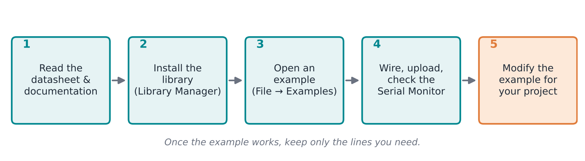

:::::::::::::::::::::::::::::::::::::: questions

- What is a library and why use one?
- How do I install a library in the Arduino IDE?
- How do I start using a library in my own sketch?

::::::::::::::::::::::::::::::::::::::::::::::::

::::::::::::::::::::::::::::::::::::: objectives

- Explain what a library is and how it saves time
- Install a library with the Library Manager
- Run a library example and adapt it for a project

::::::::::::::::::::::::::::::::::::::::::::::::

## What is a library?

Libraries are collections of pre-written code that simplify the development
of a sketch, especially when controlling complex hardware such as sensors,
motors and displays. Many components communicate with the board in ways that
would take a lot of code, and a lot of time, to handle ourselves. A library
does that work for us, so we can focus on our project.

Most Arduino libraries are written by members of the open-source community,
companies and individuals alike, who share their work freely. Thanks to them,
a sensor that would take weeks to program from scratch can be working in
minutes.

::::::::::::::::::::::::::::::::: callout

### Giving back

Libraries exist because people chose to share their work. We can return the
favour: credit the authors in our projects, report problems politely when we
find them, and share our own improvements.

:::::::::::::::::::::::::::::::::::::::::

### Example: a servo motor

The small motor we switched with a relay could only be turned on and off. A
**servo motor** is different: it turns to a precise angle, with force. It can
open and close a gate for chickens, or move a valve. The calculations behind
it are complicated, but with the `Servo` library, turning it to 90 degrees
takes one line:

```C
// 1. Include the library
#include <Servo.h>

// 2. Create a library object
Servo myServo;

void setup() {
  // 3. Initialize the hardware pin
  myServo.attach(9);
}

void loop() {
  // 4. Call a library function
  myServo.write(90);    // turn to 90 degrees
  delay(1000);
}
```

Almost every library is used in these four steps: **include** the library →
**create** an object → **initialize** it in `setup()` → **call** its functions
in `loop()`.

::::::::::::::::::::::::::::::::: callout

### You don't need to be a programmer

Most libraries use a style called object-oriented programming (OOP): that is
where lines like `Servo myServo;` and `myServo.write(90);` come from. You do
not need to learn OOP to use a library: the documentation and the examples
show exactly which lines to write. You can always study it later, for your
own pleasure.

:::::::::::::::::::::::::::::::::::::::::

## Installing a library

**Method 1: the Library Manager (recommended).** In the Arduino IDE, go to
**Tools → Manage Libraries** (in IDE 2 you can also click the books icon on
the left). Search for the library by name and click **Install**.

Often several libraries do the same job. To choose:

- prefer well-known authors and publishers with good documentation
  (for example Adafruit, DFRobot or Rob Tillaart);
- check that it supports your board: some libraries are written only for the
  ESP32, others only for Arduino boards;
- read its short description before installing.

**Method 2: a ZIP file.** If a library is not in the Library Manager (for
example, a colleague wrote it), download its ZIP file and add it with
**Sketch → Include Library → Add .ZIP Library**. Installed libraries are kept
in the `libraries` folder inside your Arduino sketchbook folder.

## Read the documentation first

Before wiring and coding, read two documents:

- the **datasheet** of the component: which supply voltage it needs (will it
  work with a 3.3 V board, a 5 V board, or both?) and what each pin does;
- the **documentation** of the library: which functions it offers and how to
  call them.

> Reading a minimum of library documentation makes you gain tons of time.

## From example to project

Well-documented libraries install **example sketches** together with the
library. They are the fastest way to learn how a library works.

{alt='Five boxes connected by arrows: 1 read the datasheet and documentation, 2 install the library with the Library Manager, 3 open an example under File, Examples, 4 wire, upload and check the Serial Monitor, 5 modify the example for your project.'}

1. Read the datasheet and the documentation (see above).
2. Install the library.
3. Open an example: **File → Examples → [name of the library]**.
4. Wire the component as described at the top of the example (good examples
   start with a comment block that explains the circuit). Select your board
   and port, upload, and open the Serial Monitor. Set its speed to the value
   written in `Serial.begin()` in the example.
5. Once the example works, start modifying it: keep only the lines you need.

### Example: temperature and humidity

Your kit contains a **DHT11**, a sensor that measures air temperature and
humidity. One library for it is **DHTNEW** by Rob Tillaart: search for
`DHTNEW` in the Library Manager, then look at its examples under
File → Examples → DHTNEW. Check the labels on your sensor before connecting
it.

<!-- OPTIONAL PHOTO: download "Dht11 term and humidity sensor.jpg" (CC BY-SA 3.0, by Crackopl)
from https://commons.wikimedia.org/wiki/File:Dht11_term_and_humidity_sensor.jpg and save it in
episodes/fig/ as dht11.jpg. Then delete the two lines "<!- -" and "- ->"
(written without spaces) around the photo below, so it becomes visible. -->

<!--
{alt='Photo of a blue DHT11 sensor module with a ventilated front and three pins.'}

Photo: Crackopl, [CC BY-SA 3.0](https://creativecommons.org/licenses/by-sa/3.0/), via Wikimedia Commons.
-->

Reduced to the essential lines, a sketch that reads the sensor looks like this:

```C
/*
  Temperature and humidity
  Reads a DHT11 sensor every two seconds and prints the values.
  Library: DHTNEW by Rob Tillaart (install it with the Library Manager)
  Circuit: VCC -> 5V, GND -> GND, DATA -> digital pin 5
*/

#include <dhtnew.h>        // 1. include the library

DHTNEW mySensor(5);        // 2. create the sensor object (pin 5)

void setup() {
  Serial.begin(9600);      // 3. start serial communication
}

void loop() {
  mySensor.read();         // 4. ask the sensor for new values

  Serial.print("Humidity: ");
  Serial.print(mySensor.getHumidity(), 1);     // 1 decimal
  Serial.print(" %   Temperature: ");
  Serial.print(mySensor.getTemperature(), 1);
  Serial.println(" C");

  delay(2000);             // wait 2 seconds between readings
}
```

::::::::::::::::::::::::::::::::::::: challenge

## Challenge 1: run an example

Install the DHTNEW library, open one of its examples, wire the sensor and run
it. Do you see the temperature and humidity in the Serial Monitor?

:::::::::::::::::::::::: solution

## If it does not work

- Check the wiring against the labels on your sensor and the pin number
  written in the example.
- Check that the board and port are selected.
- Check that the speed in the Serial Monitor matches `Serial.begin()` in the
  example: if they differ, you will see strange characters or nothing at all.

:::::::::::::::::::::::::::::::::

::::::::::::::::::::::::::::::::::::::::::::

::::::::::::::::::::::::::::::::::::: challenge

## Challenge 2: a simple thermostat

Combine this episode with the previous one: switch on a relay (on pin 7) when
the temperature drops below 18 °C, and switch it off otherwise. In a real
greenhouse, the relay would control a heater. Never connect a heater directly
to the board!

:::::::::::::::::::::::: solution

## One possible solution

```C
#include <dhtnew.h>

const int RELAY_PIN = 7;
DHTNEW mySensor(5);

void setup() {
  pinMode(RELAY_PIN, OUTPUT);
}

void loop() {
  mySensor.read();
  float temperature = mySensor.getTemperature();

  if (temperature < 18) {
    digitalWrite(RELAY_PIN, HIGH);   // too cold: heater on
  } else {
    digitalWrite(RELAY_PIN, LOW);    // warm enough: heater off
  }

  delay(2000);
}
```

:::::::::::::::::::::::::::::::::

::::::::::::::::::::::::::::::::::::::::::::::::

::::::::::::::::::::::::::::::::::::: keypoints

- Libraries are pre-written code, mostly shared freely by the community, that let us use complex hardware quickly.
- Install libraries with the Library Manager; prefer well-documented ones that support your board.
- Read the component's datasheet and the library's documentation before wiring and coding.
- Most libraries follow four steps: include, create an object, initialize it in setup(), call its functions in loop().
- Start from a working example, then modify it for your project.

::::::::::::::::::::::::::::::::::::::::::::::::
