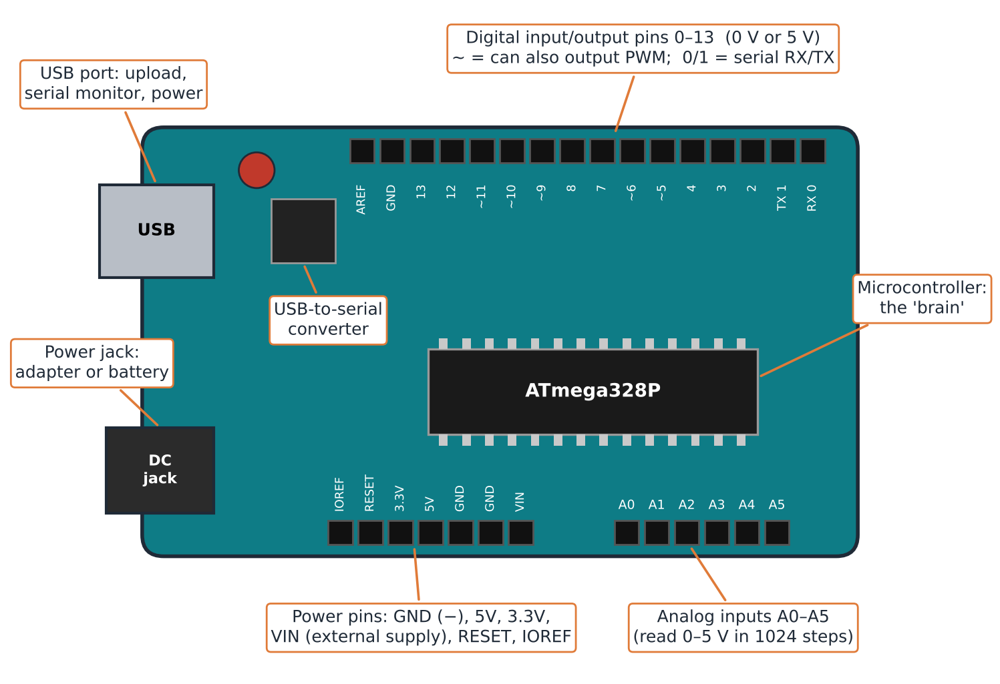
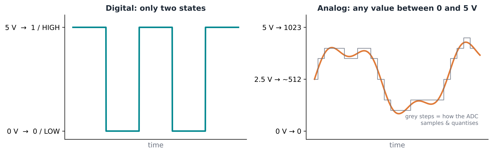

:::::::::::::::::::::::::::::::::::::: questions

- What is a microcontroller development board?
- How does the board connect to a computer, to power and to the environment?
- What is the difference between digital and analog pins?
- How does Arduino compare with other boards such as the Raspberry Pi?

::::::::::::::::::::::::::::::::::::::::::::::::

::::::::::::::::::::::::::::::::::::: objectives

- Identify the main parts of an Arduino board
- Distinguish digital, analog and power pins
- Compare Arduino with other microcontroller boards and with a single-board computer

::::::::::::::::::::::::::::::::::::::::::::::::

## The microcontroller development board

The Arduino is a **microcontroller development board**:

- The **microcontroller** is the large chip in the centre: the "brain" that
  runs our program.
- The **board** around it gives us access to the microcontroller's **pins**,
  which is what makes it possible to program it and connect it to the world.

{alt='Drawing of an Arduino Uno with labels: USB port, USB-to-serial converter, power jack, microcontroller chip, digital pins 0 to 13 along the top, power pins and analog pins A0 to A5 along the bottom.'}

### USB port

Next to the USB port sits a **serial-to-USB converter**. Thanks to it, the
same cable lets us:

- **program** the board,
- **communicate** with it,
- **power** it.

### Power port

Many boards have an extra power input: a **barrel jack** or a second USB port.
Once the board is programmed, you can unplug the computer, connect an adapter
or a battery, and the board keeps doing its job as it was programmed.

## The pins

| Pin group | Where | What it does |
|-----------|-------|--------------|
| Digital (0–13) | One side of the board | Input or output, either **0 or 1** |
| Analog (A0–A5) | Opposite side | Read a **range of voltages** |
| Power | Next to the analog pins | Supply voltage and close the circuit |

### Digital pins

A digital value is either **1 or 0**. On this board that means **5 V or 0 V**:

- as an **output**, the pin emits 0 V or 5 V;
- as an **input**, the microcontroller detects whether 5 V (1) or 0 V (0)
  arrives at the pin.

Numbering starts at **0**: the digital pins go from 0 to 13.

### Analog pins

Analog pins read a **series of voltage values**, for example anything between
0 and 5 V. They can tell the difference between, say, 1.2 V and 3.4 V.

Between 0 and 5 V there are theoretically infinite values, so what matters is
the **resolution**. On the Arduino Uno the analog pins divide 0–5 V into
**1024 steps (0 to 1023)**, so each step is about **5 mV**.

{alt='Two graphs. Left: a digital signal jumping between 0 V (0) and 5 V (1). Right: an analog signal varying smoothly between 0 and 5 V, mapped to values from 0 to 1023.'}

### Power pins

| Pin | Role |
|-----|------|
| **GND** (ground) | The negative pole. Everything connects to the same ground: this is how every circuit is closed. |
| **5V** / **3.3V** | The positive supply, at 5 V or 3.3 V. |
| **RESET** | Restarts the board when triggered. |
| **VIN** | Provides positive voltage to the board from an external supply. |

## Boards for learning, boards for products

There are many similar boards:

- **Arduino Uno**: the reference board we use to learn.
- **Arduino Mega**: same layout, more pins and more memory for larger programs.
- **ESP32**: another popular microcontroller board.
- **Arduino Nano** and other small boards: good for a final product, but hard
  to learn on because the pin labels are tiny.

Full-size boards are very good for **prototyping**. Once you are confident,
you move to a smaller form factor for the final product.

## Arduino vs Raspberry Pi

The Raspberry Pi did something similar but different: a **system on a board**.
Besides the processor it has a GPU, RAM and storage, plus USB and LAN ports.
It is a fully working, very powerful microcomputer, and it also has pins.

But its operating system is **energy- and resource-demanding**, and it
**loses precision in repetitive tasks** that must happen at exactly the right
time. An Arduino runs only our program, directly on the microcontroller.

::::::::::::::::::::::::::::::::: callout

### The specialist and the professor

The Arduino is a **very specialized worker** with one tool. The Raspberry Pi
is a **professor** who knows everything but is slower at doing one specific
task.

:::::::::::::::::::::::::::::::::::::::::

::::::::::::::::::::::::::::::::::::: challenge

## Challenge: know your board

Take your board and find: the microcontroller, the USB port, the power port,
a GND pin, digital pin 13 and analog pin A0.

Then: a sensor gives a voltage that changes gradually between 0 and 5 V.
Which kind of pin do you connect it to?

:::::::::::::::::::::::: solution

## Answer

An **analog** pin (A0–A5): it can read the whole range of voltages. A digital
pin would only see 0 or 1.

:::::::::::::::::::::::::::::::::

::::::::::::::::::::::::::::::::::::::::::::::::

With Arduino, the limit is your creativity. It is not as complicated or as
"nerdy" as it looks: the aim is to realize that you can build whatever you need.

::::::::::::::::::::::::::::::::::::: keypoints

- An Arduino is a microcontroller (the brain) on a board that gives access to its pins.
- The USB port programs, communicates with and powers the board; a power port lets it run on its own.
- Digital pins are 0 or 1 (0 V or 5 V); analog pins read a range of voltages (0–1023 on the Uno).
- GND closes every circuit; 5V, 3.3V and VIN provide the positive supply.
- Arduino is a specialist: simpler, cheaper on energy and more precise in timing than a Raspberry Pi.

::::::::::::::::::::::::::::::::::::::::::::::::
