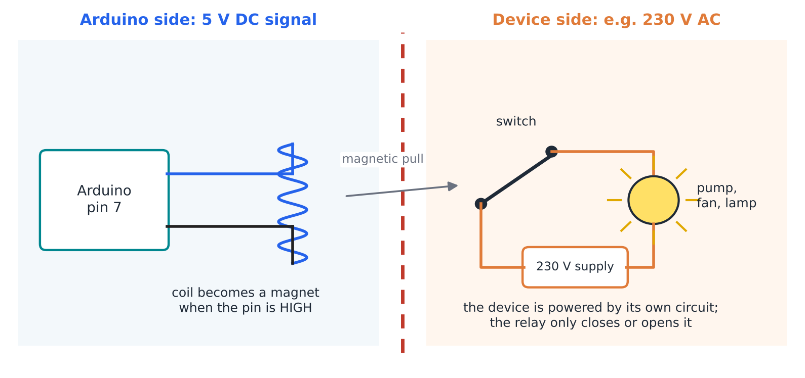
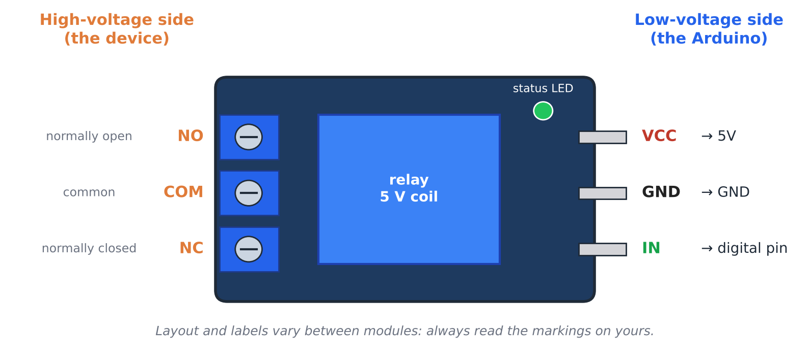
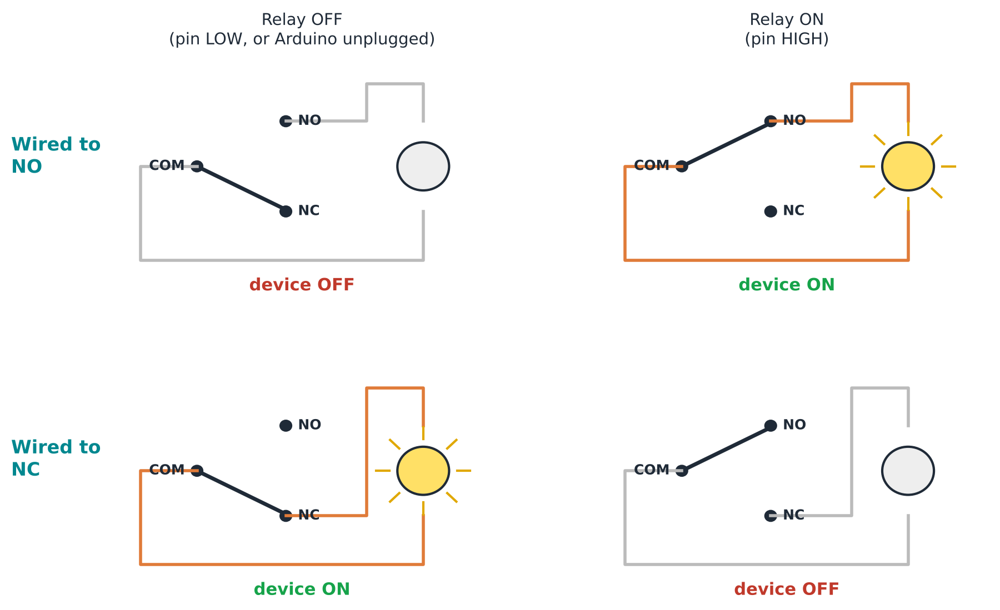
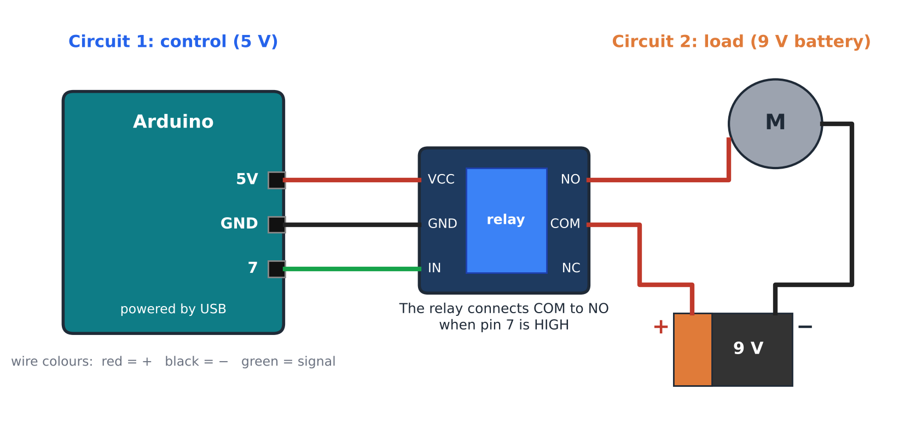

:::::::::::::::::::::::::::::::::::::: questions

- Why can't we connect a pump or a lamp directly to an Arduino pin?
- What is a relay and how does it keep two circuits separate?
- How do I read the specifications of a relay?
- What is the difference between normally open and normally closed?

::::::::::::::::::::::::::::::::::::::::::::::::

::::::::::::::::::::::::::::::::::::: objectives

- Explain why low-voltage boards need a relay to control high-voltage devices
- Read the label and the connections of a relay module
- Wire a relay module and control it from a digital pin
- Choose between normally open and normally closed wiring for an agricultural device

::::::::::::::::::::::::::::::::::::::::::::::::

## Why we need relays

So far we have switched an LED on and off. But what if we want to switch on
a lamp, a fan, a water pump, a heating system or a dryer? These are much
heavier loads, and they cannot be connected to the Arduino the way we
connected the LED. In the worst case this starts a fire; in the best case it
destroys the board.

The reason is that the microcontroller unit (MCU), whether an Arduino or an
ESP32, works in a completely different range from real-world devices:

|             | Microcontroller (MCU)      | Real-world devices                   |
|-------------|----------------------------|--------------------------------------|
| Voltage     | 3.3–5 V direct current (DC) | 120–250 V alternating current (AC), or 12–24–48 V DC |
| Current     | very low (max. ~20 mA per pin) | often 1–10 A                       |

Think of voltage as the pressure of water in a pipe. The 5 V of an Arduino
is a gentle pressure. The 230 V of a wall socket is a pressure that would
burst our pipes.

::::::::::::::::::::::::::::::::: callout

### Arms and muscles

If the microcontroller is the logic brain, relays are the physical arms and
muscles that let it control higher-voltage devices.

:::::::::::::::::::::::::::::::::::::::::

## How a relay works

A relay is a **switch operated by electricity**. Inside the box there are two
separate parts:

1. A **coil**. When the Arduino sends a 5 V signal, the coil becomes a magnet.
2. A **switch**. The magnet pulls it, and it closes (or opens) the circuit of
   the device. You can hear it: every time the relay switches, it **clicks**.

{alt='Diagram split in two by a dashed line. Left, the Arduino side: pin 7 connected to a coil. Right, the device side: a switch, a 230 V supply and a lamp in a loop. An arrow labelled magnetic pull goes from the coil to the switch.'}

The two circuits never touch: the relay creates an **electrical separation**
between the MCU and the high-voltage circuit. The device is still powered by
its own circuit. **We are sending a signal, we are not powering the device**:
the Arduino only opens and closes the switch.

## Reading the label

Before using a relay, read its technical specifications. They are printed,
very small, on the blue box. A common relay reads:

| Printed on the relay | Meaning |
|----------------------|---------|
| `10A 250VAC`         | Can switch up to 10 A at up to 250 V AC (wall sockets in Europe, Africa, most of Asia) |
| `10A 125VAC`         | Can switch up to 10 A at up to 125 V AC (wall sockets in the Americas) |
| `10A 30VDC`          | Can switch up to 10 A at up to 30 V DC (e.g. 12 or 24 V systems) |
| `SRD-05VDC-SL-C`     | **05VDC**: the relay is triggered by a **5 V** signal |

The last line is the one that matters most for us: it tells us which signal
voltage switches the relay.

::::::::::::::::::::::::::::::::: callout

### 3.3 V boards

Some MCUs, such as the ESP32, can only send signals of 3.3 V. With them,
either buy a relay module that is triggered at 3.3 V, or use a **logic level
converter**: a small additional board that turns a 3.3 V signal into a 5 V one.

:::::::::::::::::::::::::::::::::::::::::

::::::::::::::::::::::::::::::::: callout

### Buy the module, not the bare relay

Always look for a **relay module**: the relay already mounted on a small
board with the components that let a pin switch it safely and protect your
board, and often an LED showing whether it is on. Bare relays are cheaper, but
need all those extra components built around them.

:::::::::::::::::::::::::::::::::::::::::

## The two sides of a relay module

Every relay module has two sides: one that goes to the Arduino, and one that
goes to the device.

{alt='Drawing of a relay module. On the left, three screw terminals labelled NO (normally open), COM (common) and NC (normally closed) for the high-voltage side. On the right, three pins labelled VCC to 5V, GND to GND and IN to a digital pin for the Arduino side. A status LED sits in the corner.'}

| Side | Connection | Connect to |
|------|------------|------------|
| Low voltage (Arduino) | **VCC** | 5V of the Arduino (powers the relay) |
|  | **GND** | GND of the Arduino |
|  | **IN** (signal) | a digital pin, e.g. pin 7 |
| High voltage (device) | **COM** (common) | one end of the wire you want to switch |
|  | **NO** (normally open) | the other end: the device is **off** until the relay switches |
|  | **NC** (normally closed) | the other end: the device is **on** until the relay switches |

To control a device, we interrupt **one** of its wires. One end goes into
COM, the other into NO or NC. The relay then closes or opens the gap.

## Normally open or normally closed?

"Normally" describes what happens when the relay is **not powered**: when the
pin is LOW, or when the Arduino is switched off or unplugged.

{alt='Four small circuit diagrams in a grid. Wired to NO: device off when the relay is off, device on when the relay is on. Wired to NC: device on when the relay is off, device off when the relay is on.'}

- **NO (normally open)**: the circuit is open, so the device is **off** by
  default. It runs only while the Arduino switches the relay on.
- **NC (normally closed)**: the circuit is closed, so the device is **on** by
  default, even when the Arduino is off. The Arduino switches it off.

::::::::::::::::::::::::::::::::: callout

### A counterintuitive name

"Normally open" sounds like "on", but it means the circuit is open: nothing
flows. This is the safe choice. If the controller or its power fails, pumps,
heaters and cooling systems switch off rather than staying on. NC is useful
when a device must keep running even if the controller fails.

:::::::::::::::::::::::::::::::::::::::::

::::::::::::::::::::::::::::::::::::: challenge

## Challenge 1: NO or NC?

For each device, would you wire it to NO or to NC? Think about what should
happen if the Arduino stops working.

1. An irrigation pump
2. A greenhouse heater
3. The ventilation fans of a poultry house

:::::::::::::::::::::::: solution

## Discussion

1. **Irrigation pump: NO.** If the controller fails, the pump stops instead
   of flooding the field and wasting water.
2. **Greenhouse heater: NO.** A heater that cannot be switched off is a risk
   of overheating the crop, or of fire.
3. **Ventilation fans: it depends.** With NC, the fans keep running if the
   controller fails, which protects the animals from heat and poor air. There
   is often no single right answer: ask yourself which failure is the less
   dangerous one.

:::::::::::::::::::::::::::::::::

::::::::::::::::::::::::::::::::::::::::::::::::

## Types of relays

- **Electromagnetic relays** (the blue box in your kit): a coil and a
  mechanical switch. They can switch heavy loads and are very reliable, but
  they are not made to switch many times per second.
- **Solid-state relays (SSR)**: no moving parts, silent and fast. The common
  low-cost modules only switch AC, and handle smaller loads.

Both come as modules with 1, 2, 4, 8 or 16 relays.

<!-- OPTIONAL PHOTO: download "Solid state relay.jpg" (public domain, by Mike1024)
from https://commons.wikimedia.org/wiki/File:Solid_state_relay.jpg and save it in
episodes/fig/ as solid-state-relay.jpg. Then delete the two lines "<!- -" and "- ->"
(written without spaces) around the photo below, so it becomes visible. -->

<!--
{alt='Photo of a black solid-state relay with screw terminals, next to a ruler.'}

Photo: Mike1024, public domain, via Wikimedia Commons.
-->

In greenhouses or poultry farms we rarely need fast switching, but we do need
something reliable that can manage heavy loads. That is why electromagnetic
relays are usually the right choice.

## Hands-on: switching a motor

We build a scale model of a real installation: two separate circuits.

- **Circuit 1, control:** the Arduino, powered by the computer, and the
  low-voltage side of the relay.
- **Circuit 2, load:** a small motor, powered by its own 9 V battery, through
  the high-voltage side of the relay.

{alt='Wiring diagram. Arduino 5V to relay VCC with a red wire, GND to GND with a black wire, pin 7 to IN with a green wire. On the other side, the battery plus goes to COM, NO goes to the motor, and the motor goes back to the battery minus.'}

1. Connect the relay's **VCC** to **5V**, **GND** to **GND**, and **IN** to
   digital **pin 7**.
2. Connect the battery's **+** to **COM**.
3. Connect **NO** to one terminal of the motor.
4. Connect the motor's other terminal to the battery's **−**.

::::::::::::::::::::::::::::::::: callout

### Wire colours

Always use the same colours for the same role, so you can read a circuit at
a glance: **red for +**, **black for −**, and a bright colour for signals.

:::::::::::::::::::::::::::::::::::::::::

The code is the same as the Blink example (File → Examples → 01.Basics →
Blink): only the pin changes. Notice the comment block at the top: describing
the goal and the wiring at the start of every sketch is a good habit.

```C
/*
  Relay blink
  Switches a relay on and off every two seconds.
  Circuit: relay module VCC -> 5V, GND -> GND, IN -> digital pin 7
*/

const int RELAY_PIN = 7;            // digital pin connected to IN

void setup() {
  pinMode(RELAY_PIN, OUTPUT);       // the pin sends a signal
}

void loop() {
  digitalWrite(RELAY_PIN, HIGH);    // relay on: listen for the click
  delay(2000);                      // wait 2 seconds
  digitalWrite(RELAY_PIN, LOW);     // relay off
  delay(2000);
}
```

Remember to select the right board and port before uploading.

::::::::::::::::::::::::::::::::::::: challenge

## Challenge 2: from NO to NC

1. Upload the sketch. What do you hear and see on the relay module?
2. Move the motor wire from **NO** to **NC**. What changes?
3. With the wire on NC, unplug the Arduino's USB cable. What does the motor do?

:::::::::::::::::::::::: solution

## Answers

1. The relay clicks every two seconds and its LED (if it has one) turns on
   and off. The motor runs while the relay is on.
2. The rhythm is reversed: the motor now runs while the relay is **off**.
3. The motor keeps running: it is powered by its own battery, and with NC
   the circuit stays closed when the relay is not powered. With NO, it would
   stop.

:::::::::::::::::::::::::::::::::

::::::::::::::::::::::::::::::::::::::::::::::::

## Controlling mains devices

The same principle works for devices plugged into a wall socket: lamps,
pumps, fans. During the session, the instructor demonstrated it with a lamp,
using the example File → Examples → 02.Digital → BlinkWithoutDelay with a
longer interval (5 seconds) on pin 7.

::::::::::::::::::::::::::::::::: caution

### Mains voltage can kill

Working with 230 V is dangerous. Leave it to the instructor or a qualified
person, and practise with battery circuits like the one above.

- A mains cable contains three wires: two that carry the current, and the
  **earth** (yellow-green). The relay interrupts **only one** current-carrying
  wire. The other wire and the **earth must stay connected** all the way to
  the device.
- Join and insulate wires with **appropriate connectors** (for example screw
  or lever terminal blocks), never with tape alone.
- Keep the relay's high-voltage terminals inside a closed box, so nobody can
  touch them.
- Never work on a circuit while it is plugged in.

:::::::::::::::::::::::::::::::::::::::::

## Relays in finished products

With a relay, almost any device can become controllable: we do not need to
buy "smart" devices. During the session, the instructor showed a box with
four relays, each controlling one socket, which was used to run the pumps,
lights and fans of a hydroponic system. Commercial smart plugs work the same
way: inside, a microcontroller drives a relay.

Turning a prototype into a reliable, safe product is a topic of its own, and
is covered in a separate unit.

::::::::::::::::::::::::::::::::::::: keypoints

- Microcontrollers work at 3.3–5 V with very small currents; real-world devices need far more, so never connect them directly.
- A relay is a switch operated by electricity: a coil on the Arduino side moves a switch on the device side, and the two circuits stay separate.
- Read the label: the maximum loads the relay can switch, and the voltage that triggers it (05VDC = 5 V).
- The Arduino side has VCC, GND and IN; the device side has COM, NO and NC.
- Normally open means off by default and is usually the safer choice; normally closed means on by default.
- The Arduino sends a signal; the device is powered by its own circuit.

::::::::::::::::::::::::::::::::::::::::::::::::
